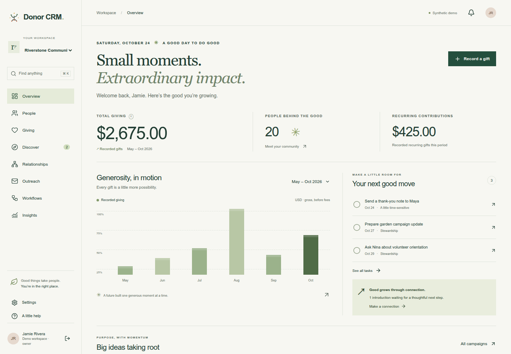
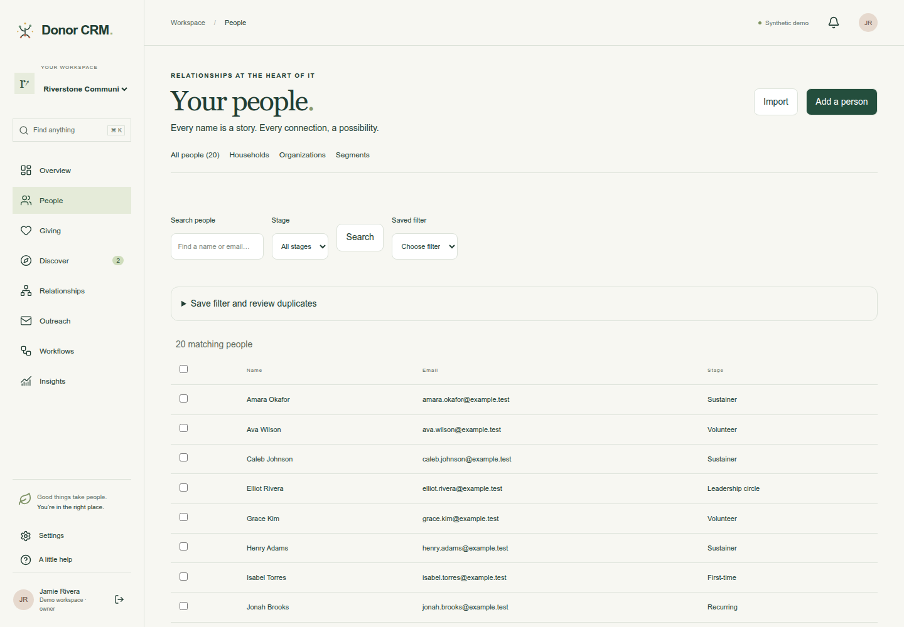
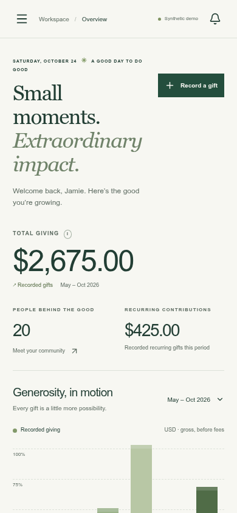
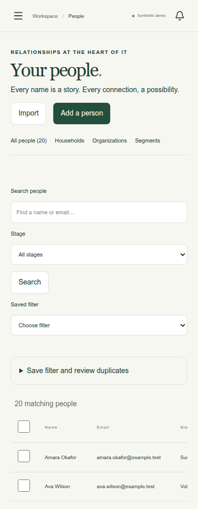

# GiveLoom

**Supporter CRM for the people doing good.**

GiveLoom brings donor relationships, fundraising, stewardship, and operations into one self-hosted workspace for nonprofit teams. Keep the full picture of a supporter—from first contact to gifts, events, and follow-up—connected in a CRM designed around consent, clear records, and careful handling of donor data.

[Visit GiveLoom](https://give.stevengerner.com) · [Explore the demo](https://demo-give.stevengerner.com/demo/start) · [Repository](https://github.com/sgerner/giveloom) · [Contributing](CONTRIBUTING.md) · [Security](SECURITY.md)

> GiveLoom is under active development. The core product paths have substantial local test coverage, but features remain in progress until their provider, deployment, and manual acceptance checks are complete. Review [feature status](FEATURE_STATUS.md) and the [validation record](docs/VALIDATION.md) before using it with real donor data.

## Product preview

Screenshots show synthetic Riverstone demo data in the desktop and mobile experience. They are stored in the repository so they remain available when GitHub renders this page.

| Desktop overview                                                    | Supporter directory                                                      |
| ------------------------------------------------------------------- | ------------------------------------------------------------------------ |
|  |  |

| Mobile overview                                                   | Mobile supporter directory                                                     |
| ----------------------------------------------------------------- | ------------------------------------------------------------------------------ |
|  |  |

## What you can do

- **Build a complete supporter record.** Organize people, households, and organizations with contact methods, addresses, consent, notes, custom fields, segments, and private attachments. Review potential duplicates, merge records with an audit trail, and import or export data.
- **Track gifts with a reliable ledger.** Record donations, pledges, installments, refunds, corrections, hard and soft credits, and household totals by currency. Receipt snapshots preserve the details used for an acknowledgment; authenticated HTML receipt downloads are available. Receipt email is not currently sent.
- **Run campaigns and events.** Publish donation campaigns and public forms, attribute gifts, manage funds and appeals, and support event registration, ticketing, volunteer sign-up, and check-in.
- **Plan stewardship.** Track activities, tasks, recurring follow-ups, assignments, reminders, stewardship plans, and proposal stages.
- **Compose thoughtful outreach.** Build reusable email templates with previews and a plain-text fallback, review consent and suppression rules, approve recipient snapshots, schedule delivery, and inspect send history. Actual sending requires configured AWS SES.
- **Coordinate workflows.** Build and validate versioned automations with triggers, waits, approvals, retries, simulations, and run history.
- **Understand relationships and research.** Map relationship paths with provenance and privacy scope. Review prospect research and caller-supplied IRS 990-PF XML imports; live research sources are disabled unless permitted sources and terms are configured.
- **See fundraising performance.** Use ledger-backed reports for gifts, fees, settlements, corrections, reconciliation, donor and household totals, saved report definitions, and audited exports.
- **Give supporters a portal.** Donors can access gift and receipt history, update profile and communication preferences, and use a secure one-time sign-in link.
- **Keep administration accountable.** Manage verified signup, recovery, invitations, roles, sessions, TOTP MFA, API tokens, webhooks, audit history, retention, tenant branding, and encrypted provider credentials.
- **Use an AI assistant with controls.** The assistant supports structured, role-filtered CRM operations with budgets, audit records, redaction, previews, and one-use confirmation for writes. A tenant supplies and pays for its own provider key; paid billing has not been validated.

Choose from 24 included themes, light/dark/system appearance, tenant branding, and responsive layouts. PWA support provides installation guidance, an explicit update prompt, and a generic offline fallback that keeps private donor pages out of the browser cache.

### Integrations and current gates

Stripe Connect payment and webhook paths, AWS SES email workflows, and OpenAI Responses API support are present in the codebase. Automated checks use test transports or local services; no live donation, email, or paid AI request was made for the recorded validation. Live credentials, provider-account scenarios, public callbacks, and operational sign-off remain outstanding. Research adapters are disabled until permitted source access is configured. See [provider contracts](docs/provider-contracts.md) and [feature status](FEATURE_STATUS.md) for specifics.

## Run the demo locally

The quickest way to explore GiveLoom does not require PostgreSQL, Redis, or provider credentials. Demo mode uses synthetic data and saves local changes in `.data/`.

Requirements: Node.js 22.21.1 or a newer supported Node.js 22 release, and npm.

```sh
git clone https://github.com/sgerner/giveloom.git
cd giveloom
npm ci
npm run dev
```

Open the local URL printed by Vite (normally `http://localhost:5173`) and choose **Explore the demo**. With no `DATABASE_URL`, the app starts in labeled demo mode. Demo data is local to that checkout and is not a durable or multi-user database. Demo mode blocks live payment, email, and other provider operations.

## Local development with PostgreSQL

Use Docker Compose for isolated local PostgreSQL and Redis, with the app running on your workstation. The following creates a private `.env` with separate database roles and unique random secrets; it refuses to overwrite an existing file.

```sh
node scripts/setup-env.mjs --dev
docker compose -f docker-compose.yml -f compose.dev.yml up -d postgres redis db-bootstrap

# Export generated development variables in this shell.
set -a
. ./.env
set +a
DATABASE_URL="$MIGRATION_DATABASE_URL" npm run db:migrate
npm run dev
```

PostgreSQL listens only on `127.0.0.1:55432`, and Redis on `127.0.0.1:56379`. The runtime role is separate from the schema owner and cannot bypass row-level security. These services use named volumes; stopping them preserves the database. Run the same Compose command with `stop` to stop development services.

Do not seed real deployments. `npm run db:seed` creates explicitly synthetic development fixtures and requires an appropriately privileged connection when used with PostgreSQL. Staff signup, recovery, invitations, and portal magic links require configured SES delivery; without it, verification emails cannot arrive. Use `npm run test:db` to exercise these paths with isolated fixtures and test transports.

For queued background work, build and start the worker in a second terminal:

```sh
npm run build:worker
node --env-file=.env build/worker.js
```

See [`.env.example`](.env.example) and [operations](docs/operations.md) for provider configuration and secret handling. Keep `.env` out of version control. The hosted homepage offers an isolated public demo at `demo-give.stevengerner.com` alongside account creation. It has its own signing key, temporary synthetic data, and no production database or provider credentials. Demo changes are shared and temporary: use sample data only. The real database app never accepts demo sessions.

### Checks

```sh
npm run format:check
npm run lint
npm run check
npm test
npm run test:db
npm run test:e2e
npm run build
```

`npm run test:db` provisions temporary PostgreSQL for migration and database-backed checks. Browser tests use Playwright and Chromium; run `npx playwright install --with-deps chromium` or set `PLAYWRIGHT_CHROMIUM_EXECUTABLE` to a compatible installed Chrome binary. The repository also includes `npm run test:browser:db`, `npm run smoke:worker`, and `ops/test-backup-restore.sh` for targeted browser, worker, and restore verification. Avoid running checks that send to real services; provider tests should use the provided test transports.

Latest recorded local validation is in [docs/VALIDATION.md](docs/VALIDATION.md). It includes the PostgreSQL suite, demo and database browser runs, worker smoke, production build, and a paired database/files restore drill. These checks do not establish live provider, production deployment, or manual assistive-technology readiness.

## Self-hosting

GiveLoom can be run with Docker Compose on a server with a DNS name. The application stack includes PostgreSQL, Redis, a migration step, the web app, background worker, and Caddy reverse proxy for automatic HTTPS. It keeps database and Redis ports private and stores application data in named volumes. A shared-host deployment can use an existing Caddy and DNS setup instead; see the [Skynet deployment runbook](docs/skynet.md) and [shared-host Compose file](compose.skynet.yml).

1. Copy `.env.example` to `.env` and replace every placeholder with unique secrets. Set `APP_DOMAIN` and `ACME_EMAIL`; configure distinct database bootstrap, app, and migration credentials and matching database URLs.
2. Point the domain to the host and allow inbound TCP 80/443 (plus UDP 443 for HTTP/3).
3. Configure an isolated private ClamAV service before production uploads; uploads fail closed when scanning is unavailable.
4. Start and inspect the stack:

   ```sh
   docker compose up -d --build
   docker compose ps
   ```

Compose starts the database and Redis, bootstraps least-privilege database roles, runs migrations, and then starts the web app, worker, and reverse proxy. Do not expose PostgreSQL or Redis publicly. Keep `.env` private, use HTTPS, and configure SES transactional email to exercise verification, recovery, invitations, and portal sign-in. Live payments and email require provider configuration and end-to-end validation.

Plan encrypted off-host backups before storing real donor data. `ops/backup.sh` creates a matched PostgreSQL dump and uploads/exports archive in the Compose backups volume; move both files to a protected off-host destination. `ops/restore.sh <database-backup.dump> <files-backup.tar.gz>` replaces active database and file contents. Rehearse restores on a disposable instance and verify tenant access and representative files before reopening traffic. A local backup alone is not disaster recovery.

Read [docs/operations.md](docs/operations.md) for migration, secrets, backup/restore, capacity, and integration operations. Deployment-specific evidence is recorded in [the Skynet runbook](docs/skynet.md). Provider acceptance, off-host recovery and manual accessibility checks remain separate from a successful deployment.

## Architecture

GiveLoom is a SvelteKit application using Svelte 5, TypeScript, PostgreSQL, Drizzle ORM, Redis, and BullMQ. PostgreSQL row-level security and tenant-scoped transaction helpers protect tenant data. Domain changes that need background work are recorded through an outbox and dispatched to the worker. The UI is responsive and includes installable PWA support.

Key references:

- [Entity relationship diagram](docs/ERD.md)
- [OpenAPI specification](docs/openapi.yaml)
- [Provider contracts](docs/provider-contracts.md)
- [Validation record](docs/VALIDATION.md)
- [Operations guide](docs/operations.md)
- [Implementation plan](IMPLEMENTATION_PLAN.md)
- [Feature status](FEATURE_STATUS.md)

## Contributing

Bug reports, focused improvements, and documentation corrections are welcome. Read [CONTRIBUTING.md](CONTRIBUTING.md) for the development workflow, checks, and pull request guidance. For security issues, use the private reporting route in [SECURITY.md](SECURITY.md).

## License

GiveLoom is distributed under the [MIT License](LICENSE).
