# Data model and ERD

This model documents the current tenant-scoped schema and explicitly labels planned portions. The first implementation keeps the current API resource shapes (`contacts`, `gifts`, `campaigns`, `tasks`, `prospects`) while adding tenant ownership and provenance in storage.

```mermaid
erDiagram
  TENANTS ||--o{ MEMBERSHIPS : has
  USERS ||--o{ MEMBERSHIPS : joins
  TENANTS ||--o{ CONTACTS : owns
  CONTACTS ||--o{ CONTACT_METHODS : has
  CONTACTS ||--o{ ACTIVITIES : records
  CONTACTS ||--o{ TASKS : relates_to
  USERS ||--o{ TASKS : assigned
  TENANTS ||--o{ AUTOMATION_DEFINITIONS : configures
  AUTOMATION_DEFINITIONS ||--o{ AUTOMATION_VERSIONS : versions
  AUTOMATION_DEFINITIONS ||--o{ AUTOMATION_RUNS : executes
  AUTOMATION_RUNS ||--o{ AUTOMATION_RUN_STEPS : records
  CONTACTS ||--o{ AUTOMATION_RUNS : context
  TASKS ||--o{ TASK_REMINDERS : reminds
  USERS ||--o{ USER_NOTIFICATIONS : receives
  CONTACTS ||--o{ STEWARDSHIP_PLANS : planned_for
  STEWARDSHIP_PLANS ||--o{ STEWARDSHIP_STEPS : contains
  CONTACTS ||--o{ PROPOSALS : asks
  TENANTS ||--o{ CAMPAIGNS : owns
  CAMPAIGNS ||--o{ GIFTS : attributes
  CONTACTS ||--o{ GIFTS : gives
  TENANTS ||--o{ PROSPECTS : tracks
  PROSPECTS ||--o{ PROSPECT_EVIDENCE : supports
  TENANTS ||--o{ OUTBOX_EVENTS : emits
  OUTBOX_EVENTS ||--o{ OUTBOX_DELIVERIES : dispatches
  TENANTS ||--o{ INTEGRATION_CONFIGS : configures
  TENANTS ||--o{ AI_USAGE : budgets
  TENANTS ||--o{ FILE_OBJECTS : stores
  TENANTS ||--o{ TENANT_BRANDING_LOGOS : publishes
  CONTACTS ||--o{ FILE_OBJECTS : attachments
  TENANTS ||--o{ EMAIL_SUPPRESSIONS : suppresses
  TENANTS ||--o{ EMAIL_SEND_BATCHES : queues
  EMAIL_SEND_BATCHES ||--o{ EMAIL_MESSAGES : contains
  CONTACTS ||--o{ EMAIL_MESSAGES : receives
  EMAIL_MESSAGES ||--o{ EMAIL_PROVIDER_EVENTS : tracks
  TENANTS ||--o{ TRANSACTIONAL_EMAIL_MESSAGES : sends

  TENANTS {
    uuid id PK
    text slug UK
    text legal_name
    text timezone
    text locale
    text currency
    text tax_id
    jsonb branding
    timestamptz created_at
  }
  USERS {
    uuid id PK
    text email UK
    text display_name
  }
  MEMBERSHIPS {
    uuid tenant_id FK
    uuid user_id FK
    text role
    text status
  }
  CONTACTS {
    uuid id PK
    uuid tenant_id FK
    text name
    text email
    text stage
    text[] tags
    timestamptz created_at
    timestamptz updated_at
  }
  CONTACT_METHODS {
    uuid id PK
    uuid tenant_id FK
    uuid contact_id FK
    text kind
    text value
    boolean preferred
  }
  ACTIVITIES {
    uuid id PK
    uuid tenant_id FK
    uuid contact_id FK
    text kind
    text summary
    timestamptz occurred_at
  }
  TASKS {
    uuid id PK
    uuid tenant_id FK
    uuid contact_id FK
    text title
    timestamptz due_at
    text priority
    text status
    uuid assigned_to FK
    jsonb recurrence
  }
  AUTOMATION_DEFINITIONS {
    uuid id PK
    uuid tenant_id FK
    text name
    text status
    integer current_version
    integer published_version
    timestamptz next_schedule_at
  }
  AUTOMATION_VERSIONS {
    uuid id PK
    uuid tenant_id FK
    uuid automation_id FK
    integer version
    jsonb definition
    jsonb validation
  }
  AUTOMATION_RUNS {
    uuid id PK
    uuid tenant_id FK
    uuid automation_id FK
    integer version
    uuid contact_id FK
    text trigger_key
    text state
    integer step_number
    integer retry_count
    timestamptz next_at
  }
  AUTOMATION_RUN_STEPS {
    uuid id PK
    uuid tenant_id FK
    uuid run_id FK
    integer step_number
    text node_id
    text state
    jsonb output
  }
  TASK_REMINDERS {
    uuid id PK
    uuid tenant_id FK
    uuid task_id FK
    uuid user_id FK
    timestamptz remind_at
    text idempotency_key UK
    text state
  }
  USER_NOTIFICATIONS {
    uuid id PK
    uuid tenant_id FK
    uuid user_id FK
    uuid task_id FK
    uuid contact_id FK
    text title
    text idempotency_key UK
    timestamptz read_at
  }
  STEWARDSHIP_PLANS {
    uuid id PK
    uuid tenant_id FK
    uuid contact_id FK
    uuid owner_id FK
    text title
    text status
    timestamptz review_at
  }
  STEWARDSHIP_STEPS {
    uuid id PK
    uuid tenant_id FK
    uuid plan_id FK
    integer position
    text kind
    timestamptz due_at
    text status
  }
  PROPOSALS {
    uuid id PK
    uuid tenant_id FK
    uuid contact_id FK
    uuid owner_id FK
    text stage
    bigint ask_minor
    char currency
    date expected_close_at
  }
  CAMPAIGNS {
    uuid id PK
    uuid tenant_id FK
    text name
    bigint goal_minor
    text currency
    text status
  }
  GIFTS {
    uuid id PK
    uuid tenant_id FK
    uuid contact_id FK
    uuid campaign_id FK
    bigint amount_minor
    text currency
    text kind
    text status
    timestamptz created_at
  }
  PROSPECTS {
    uuid id PK
    uuid tenant_id FK
    text name
    text stage
    numeric score
    text match_status
  }
  PROSPECT_EVIDENCE {
    uuid id PK
    uuid tenant_id FK
    uuid prospect_id FK
    text source_name
    text source_url
    text evidence_type
    text confidence
    timestamptz observed_at
  }
  OUTBOX_EVENTS {
    uuid id PK
    uuid tenant_id FK
    text event_type
    jsonb payload
    text idempotency_key UK
    timestamptz created_at
    timestamptz processed_at
  }
  OUTBOX_DELIVERIES {
    uuid id PK
    uuid tenant_id FK
    uuid outbox_event_id FK
    text queue_name
    text status
    integer attempts
    text last_error
  }
  INTEGRATION_CONFIGS {
    uuid tenant_id FK
    text provider
    text credential_id
    boolean enabled
    text credential_envelope
    jsonb metadata
    uuid updated_by FK
  }
  AI_USAGE {
    uuid id PK
    uuid tenant_id FK
    uuid user_id FK
    text model
    char prompt_hash
    integer input_chars
    integer output_tokens
    text status
  }
  FILE_OBJECTS {
    uuid id PK
    uuid tenant_id FK
    uuid object_id
    uuid contact_id FK
    text original_name
    text media_type
    bigint size_bytes
    text scan_status
  }
  TENANT_BRANDING_LOGOS {
    uuid tenant_id FK
    uuid id PK
    uuid object_id UK
    text media_type
    bigint size_bytes
    text scan_status
    uuid uploaded_by FK
    timestamptz created_at
  }
  EMAIL_SUPPRESSIONS {
    uuid tenant_id FK
    text email
    text reason
    text source
    timestamptz created_at
  }
  EMAIL_SEND_BATCHES {
    uuid id PK
    uuid tenant_id FK
    uuid email_id FK
    uuid preview_id FK
    uuid approved_by FK
    text status
    integer recipient_count
  }
  EMAIL_MESSAGES {
    uuid id PK
    uuid tenant_id FK
    uuid batch_id FK
    uuid contact_id FK
    text to_address
    text html_body
    uuid segment_id
    text idempotency_key UK
    text provider_message_id
    text status
    integer attempts
  }
  EMAIL_TEMPLATES {
    uuid id PK
    uuid tenant_id FK
    text name
    text subject
    text html_body
    text text_body
    jsonb variables
  }
  EMAIL_CONSENT_REQUESTS {
    uuid id PK
    uuid tenant_id FK
    uuid contact_id FK
    text email
    char token_hash UK
    text token_envelope
    text status
    timestamptz expires_at
  }
  EMAIL_PREFERENCE_TOKENS {
    uuid id PK
    uuid tenant_id FK
    uuid contact_id FK
    char token_hash UK
    timestamptz expires_at
  }
  EMAIL_PROVIDER_EVENTS {
    uuid id PK
    uuid tenant_id FK
    text sns_message_id
    text provider_message_id FK
    text event_type
    timestamptz received_at
  }
  TRANSACTIONAL_EMAIL_MESSAGES {
    uuid id PK
    uuid tenant_id FK
    text to_address
    text body_envelope
    text idempotency_key UK
    text provider_message_id
    text status
  }
  GIFT_RECEIPTS {
    uuid id PK
    uuid tenant_id FK
    uuid gift_id FK
    jsonb snapshot
    timestamptz created_at
  }
```

## Invariants for migrations

- Every tenant-owned row carries `tenant_id`; tenant-aware foreign keys include it (for example `(tenant_id, contact_id)`) so a row cannot point into another tenant.
- Enable and force PostgreSQL row-level security on tenant-owned tables. The application sets the active tenant inside each transaction after membership authorization; never trust a request's tenant identifier by itself.
- Persist UUID identifiers, UTC timestamps, and money as integer minor units plus ISO 4217 currency. Do not use floating point for money.
- Preserve gifts as immutable financial events. Corrections are additional events with actor, reason, and reference to the corrected event.
- Outbox rows are inserted in the same transaction as domain changes. A unique idempotency key guards repeated event creation; dispatch is at least once and consumers must be idempotent.
- Keep evidence source, publication/observation time, license/use restrictions, match confidence, and review status with prospect research. A public affiliation does not imply a personal relationship or donation.
- Add created/updated timestamps and actor IDs for mutable records; use soft deletion or explicit archive state where history must remain auditable.

Migrations through `0033_collection_directory.sql` implement the current tenant-scoped schema. `0013` adds automation, reminder, notification, stewardship-plan and proposal tables; `0018` adds email templates, double-opt-in requests, preference tokens, scheduled send snapshots, HTML bodies and aggregate delivery metrics. Later migrations add expanded workflows, saved reports, payment/portal and public campaign/event state, contact directory indexes, platform administration, and tenant branding. `0032_tenant_branding.sql` adds RLS-protected logo metadata; tenant public-name/theme and logo-consent state are stored in `tenants.branding`, while legal name, tax ID, timezone and locale are tenant settings. Public logo delivery is through a dedicated image-only route and requires explicit public consent; private file objects are not exposed. `0033_collection_directory.sql` adds active contact and workspace directory indexes. Tenant-owned tables use FORCE RLS. Automation versions are immutable; a workflow run and its next BullMQ outbox event are committed atomically, and run-step uniqueness makes replay safe. Scheduled email batches store a hash of the exact recipients, sender, time zone and content; only a matching due batch is dispatched. `processed_at` on outbox means durable dispatch to BullMQ. `file_objects` stores metadata and a private opaque filesystem object ID; file bytes remain outside PostgreSQL. Transactional email bodies are envelope-encrypted because they may contain a single-use portal link; consent-link tokens are also encrypted until worker delivery and stored as hashes thereafter. `gift_receipts` keeps one immutable snapshot per eligible recorded gift; it is a downloadable acknowledgment, not proof of email delivery or tax-deductibility advice. Open events only increment an aggregate counter and are unreliable evidence of reading. Schema presence alone does not establish complete feature behavior; documented gaps and required checks remain in [feature status](../FEATURE_STATUS.md). Empty-database and repeat-migration runs passed; the paired PostgreSQL database/files restore drill also passed. Browser and operational deployment checks remain tracked in [validation](VALIDATION.md).
